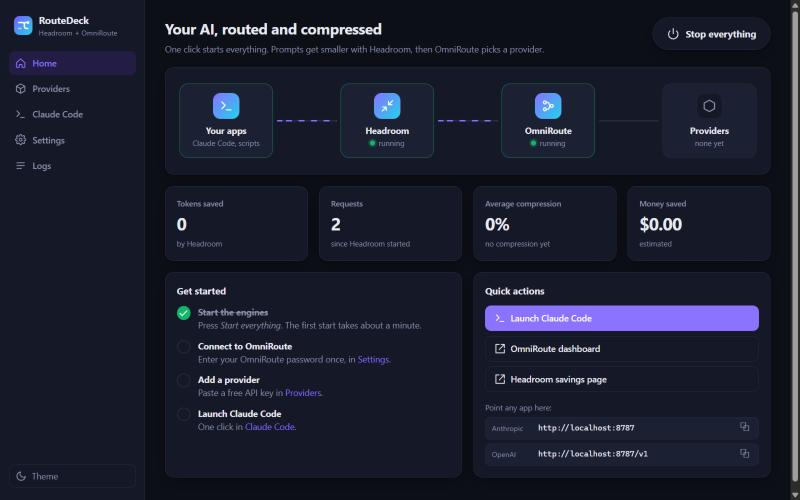
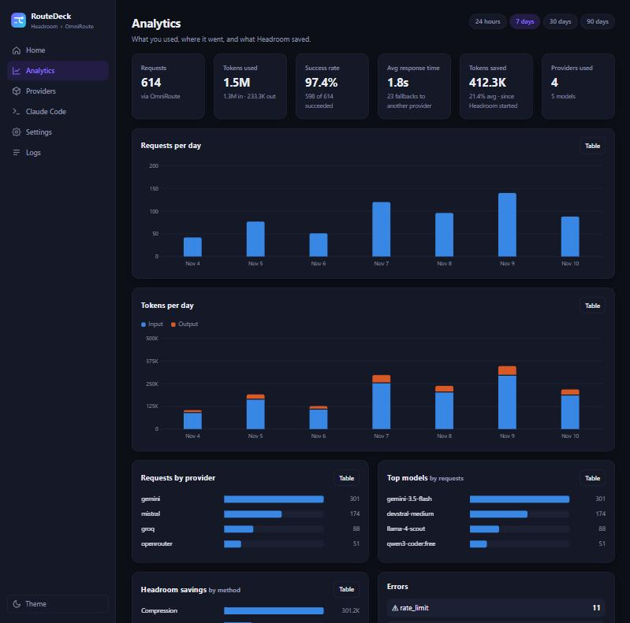
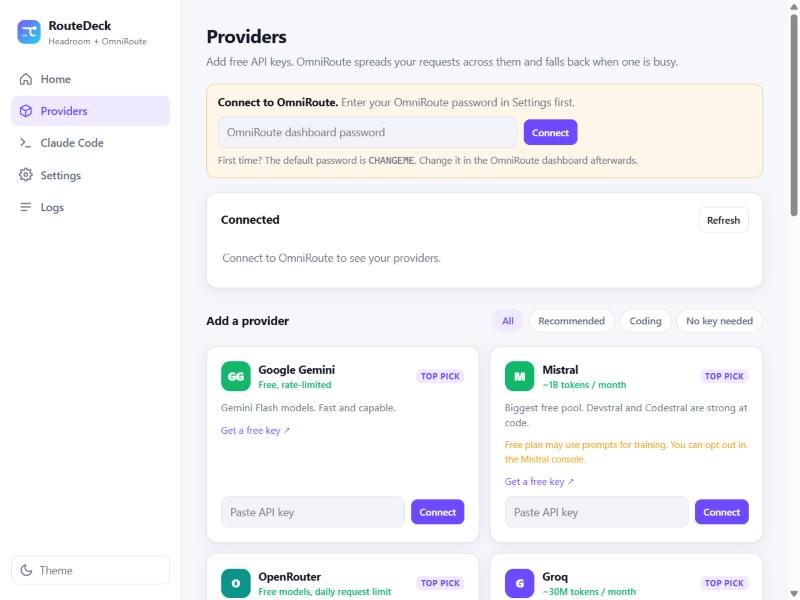
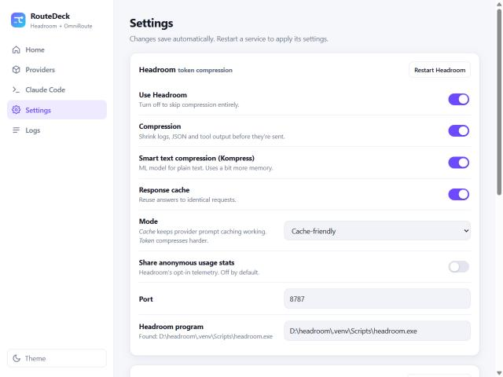

<div align="center">


# RouteDeck

**Free AI for Claude Code, in one click.**

Paste a few free API keys. Press **Start**. Your prompts get compressed by
[Headroom](https://github.com/headroomlabs-ai/headroom) and routed across free providers by
[OmniRoute](https://github.com/cheaper-inference/OmniRoute), all from one friendly dashboard.

[](LICENSE)




</div>

---

## Why

Headroom and OmniRoute are great together, but wiring them up by hand looks like this:

| Without RouteDeck | With RouteDeck |
| --- | --- |
| Install two tools, keep two terminal windows open | Double-click **RouteDeck** |
| Remember ports, URL formats and flags (`--anthropic-api-url`, no `/v1`…) | One **Start everything** button |
| Set five environment variables before launching Claude Code | One **Launch Claude Code** button |
| Find each provider's sign-up page, paste keys in a complex dashboard | A curated list of free providers with **Get a free key** links |
| Read logs in scattered windows | Live status, savings and logs on one page |

## What you get

- ⚡ **One click**: start or stop Headroom and OmniRoute together, in the right order.
- 🔑 **Easy keys**: 15 hand-picked free providers (Gemini, Mistral, OpenRouter, Groq, Nara, LLM7, GitHub Models…), plus four that need **no key at all**.
- 🧭 **Live flow map**: see your traffic go *Your apps → Headroom → OmniRoute → Providers*.
- 📊 **Analytics with graphs**: requests and tokens per day, top providers and models, success rate, response time, fallbacks, errors, and Headroom savings by method. Hover any chart for details, or switch it to a table.
- 📉 **Savings**: tokens saved, compression rate and estimated money saved, plus a live activity chart.
- 🐴 **[Ponytail](https://github.com/DietrichGebert/ponytail) built in**: install the "write less code" Claude Code plugin with one click and pick its mode (lite, full, ultra).
- 🖥️ **Claude Code launcher**: pick a route and a model, then click. Or copy the ready-made command.
- 🎛️ **Simple settings**: turn compression, the ML compressor, caching, or either service on and off with switches.
- 🚀 **Start with Windows** (optional): everything is ready when you sign in.
- 🔒 **Local only**: the dashboard answers this computer only. Your keys go straight into your own OmniRoute.
- 🪶 **Zero dependencies**: one small Node.js server and a plain HTML page.

<div align="center">

<br /><sub>Analytics page (sample data)</sub>
</div>

<table>
<tr>
<td></td>
<td></td>
</tr>
</table>

## How it works

```
 Claude Code / your apps
          │  ANTHROPIC_BASE_URL=http://localhost:8787
          ▼
 ┌──────────────────┐   compresses logs, JSON, tool output
 │  Headroom :8787  │   (fewer input tokens, same answers)
 └────────┬─────────┘
          ▼
 ┌──────────────────┐   picks a provider, falls back when one
 │ OmniRoute :20128 │   is busy or out of free quota
 └────────┬─────────┘
          ▼
   Gemini · Mistral · OpenRouter · Groq · Nara · …
```

RouteDeck itself is a small control panel at `http://localhost:7777`. It starts the two services,
talks to OmniRoute's management API to add your keys, and reads Headroom's stats.

## Quick start

**1. Install the engines** (one time):

```bash
npm install -g omniroute
pip install "headroom-ai[proxy]"
npm install -g @anthropic-ai/claude-code   # optional, for the Claude Code button
```

**2. Get RouteDeck:**

```bash
git clone https://github.com/Harshit1404005/routedeck
cd routedeck
```

**3. Run it:**

- **Windows:** double-click `RouteDeck.cmd`
- **macOS / Linux:** run `./routedeck.sh`
- or anywhere: `node server.mjs`

Your browser opens on the dashboard. Then:

1. Press **Start everything**. The first start takes about a minute.
2. **Providers** → enter your OmniRoute password (first time: `CHANGEME`, then change it in OmniRoute).
3. Paste a free key, or connect a **No key needed** provider.
4. **Claude Code** → pick a model → **Launch Claude Code**.

> Already running OmniRoute from a source checkout? In **Settings**, set *OmniRoute folder* to that
> folder and RouteDeck runs `npm run dev` there. Headroom in a virtualenv? Point *Headroom program* at
> its `headroom` executable.

## Ponytail

[Ponytail](https://github.com/DietrichGebert/ponytail) is a Claude Code plugin that makes the agent
write only the code a task needs, without dropping validation, error handling or security. On the
**Claude Code** page, click **Install** (this runs `claude plugin marketplace add DietrichGebert/ponytail`
and `claude plugin install ponytail@ponytail`), then pick a mode. RouteDeck passes the mode as
`PONYTAIL_DEFAULT_MODE` when it launches Claude Code. **Remove** uninstalls it.

## Analytics

The **Analytics** page combines two sources:

- **OmniRoute** (needs your OmniRoute password): requests, tokens, success rate, response time,
  fallbacks, errors, and breakdowns by provider and model, for 24 hours, 7, 30 or 90 days.
- **Headroom** (always on): tokens saved and savings by method. RouteDeck also records Headroom's
  totals every 5 minutes (kept for 7 days in `~/.routedeck/history.json`) to draw activity over time.

## Settings

Saved in `~/.routedeck/config.json` (readable only by you).

| Setting | What it does |
| --- | --- |
| Use Headroom / Use OmniRoute | Skip either service entirely |
| Compression | Headroom's main compression (`--no-optimize` when off) |
| Smart text compression | Headroom's Kompress ML model (`--disable-kompress` when off) |
| Response cache | Reuse answers to identical requests (`--no-cache` when off) |
| Mode | *Cache-friendly* keeps provider prompt caching; *Max savings* compresses harder |
| Share anonymous usage stats | Headroom's telemetry beacon. **Off by default.** |
| Start everything when RouteDeck opens | True one-click start |
| Start with Windows | Adds RouteDeck to your Startup folder |

## FAQ

**Is this free?** RouteDeck is free and MIT-licensed. The models are free up to each provider's
limits. OmniRoute estimates the combined free tiers at about 1.6B tokens a month if you connect them
all. You still need to sign up for each provider yourself.

**Does it work with the Claude desktop app?** No. The desktop app always talks to Anthropic
directly. RouteDeck works with Claude Code in a terminal, and with any app that lets you set an
Anthropic or OpenAI base URL.

**Will Claude Code be as good on free models?** Claude Code is built for Claude. Other models work,
but file editing and tool use can be less reliable. Pick a strong coding model.

**Claude Code says the model "isn't recognized".** That's harmless. Claude Code doesn't know
non-Claude model names, so it assumes a 200k context.

**Which providers should I avoid?** Anything OmniRoute marks *ToS-restricted* (for example
Antigravity or Kiro). Routing them through a proxy can get your account suspended.

**Where are my keys stored?** In your own OmniRoute (encrypted at rest). RouteDeck only keeps your
OmniRoute password and optional API key in `~/.routedeck/config.json`.

## Credits

RouteDeck is a launcher. The hard work is done by:

- [OmniRoute](https://github.com/cheaper-inference/OmniRoute): the multi-provider AI router
- [Headroom](https://github.com/headroomlabs-ai/headroom): the context compression proxy
- [Ponytail](https://github.com/DietrichGebert/ponytail): the "write less code" Claude Code plugin

RouteDeck isn't affiliated with any of these projects or with Anthropic.

## License

[MIT](LICENSE)
